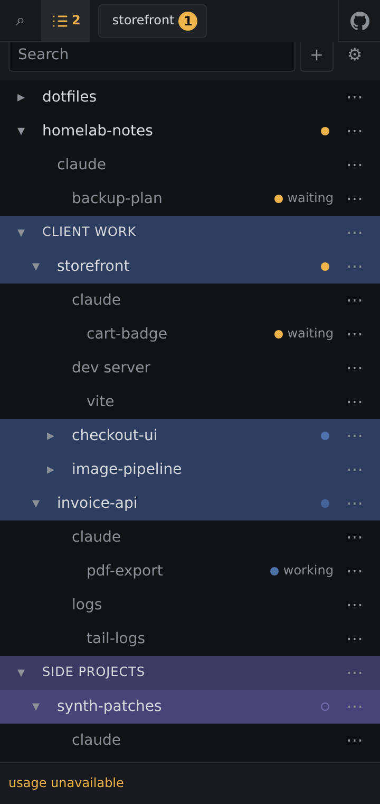
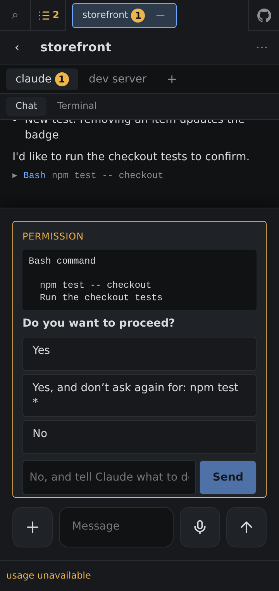
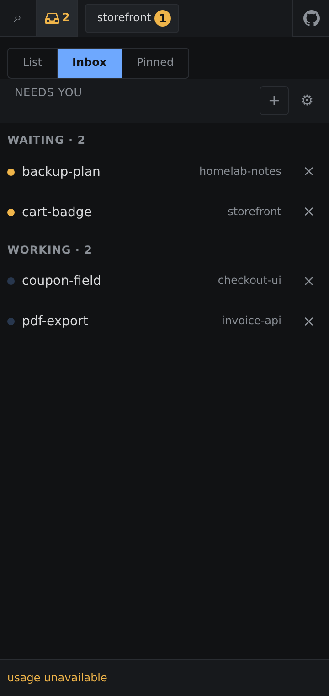
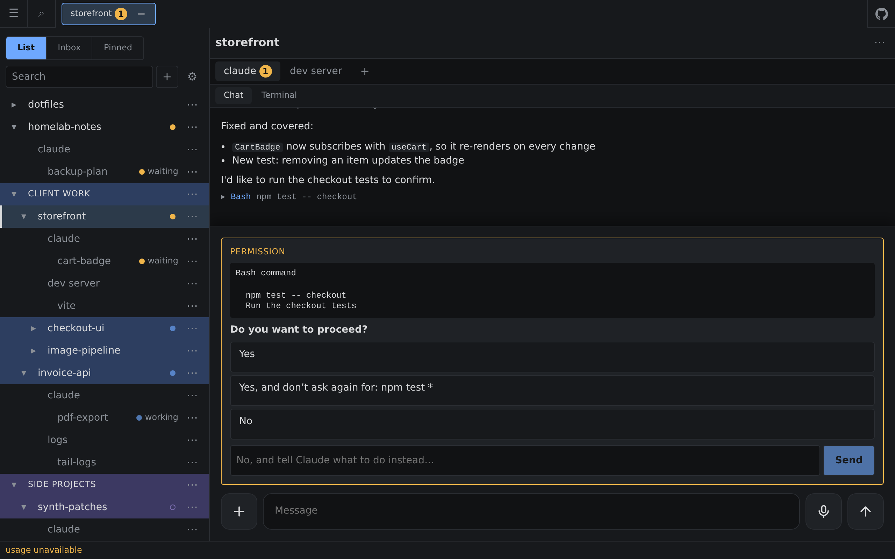

# herdr-web

A browser client for [herdr-core](https://herdr.dev), on phone and desktop. Built for Claude Code
sessions running under herdr-core: your Herdr spaces, each session as a chat, and terminals. Runs
next to herdr-core; reach it over your tailnet.

Landing page: [herdr-web on GitHub Pages](https://dissonantp.github.io/herdr-web/) · Screenshots
below use a made-up demo world.

<p>
  
  
  
</p>



> [!WARNING]
> **herdr-web is effectively root access to your machine.** It starts programs and types into
> terminals as your user. Read [Security](#security) before you install it.

## What it does

Chat
- Live chat view of any session: markdown, folded tool calls and thinking, edits as diffs
- Permission prompts, questions and plan approvals as buttons, plus a free-text answer
- Reply, stop, attach files and photos, slash commands with autocomplete
- New sessions with model, effort and permission mode; resume past ones

Spaces
- One tree of groups, nested spaces, tabs and panes, with status that bubbles up
- Create, rename, move, colour and delete at every level
- Search, Ctrl+P launcher, pins
- Same spaces and tabs as Herdr Desktop, live

Terminals
- Real terminal (ghostty-web) in any tab, with an Esc/Tab/Ctrl/arrows bar on phones

Notifications
- Push when an agent needs input, finishes or dies; agents can also push with a `herdr.notify` label
  (`hc label "$HC_TERMINAL_ID" herdr.notify="Deploy finished"`)
- "Needs you" inbox, waiting sessions first
- Mute or quiet a space, or pause everything

Sleep
- Sleep idle sessions to free memory, by hand or after a set idle time; resume in the same pane.
  Working or waiting sessions are never slept.

App
- Installable PWA with its own login
- A Settings page (auto-sleep and its idle time, the inbox view, the notification pause), shared across devices

## Limits

- Chat, prompts as buttons, session status, automatic push and sleep/resume need Claude Code. The tree,
  terminals and `herdr.notify` pushes work with any program; other agents can be added as an agent adapter
  (`packages/server/src/adapters/agent.ts`).
- Linux with systemd only. It must run on the same machine as herdr-core.
- Not built for the public internet; see [Security](#security).

## Requirements

- Linux with systemd user services (the installer runs herdr-web as one).
- [Node.js](https://nodejs.org) 24.7 or newer (the server runs TypeScript directly and uses
  Node's own argon2).
- [herdr-core](https://herdr.dev) (`hc`), running your sessions:
  `curl -fsSL https://releases.herdr.dev/core/install.sh | sh`
- [Claude Code](https://docs.claude.com/en/docs/claude-code), at `~/.local/bin/claude` (the native
  install's path; set `HERDR_CLAUDE_COMMAND` for another).
- A way to reach it privately over HTTPS, such as [Tailscale](https://tailscale.com) (see
  [Security](#security)).

## Install

```sh
git clone https://github.com/dissonantP/herdr-web.git
cd herdr-web
./install.sh apply
```

`./install.sh apply` runs every step that is not done yet, in order; `./install.sh steps` lists them,
and `./install.sh apply <step>` runs one. The steps:

- `build`: installs dependencies and builds the UI.
- `dirs`: makes herdr's config and state folders private (0700).
- `login`: asks for the app's username and password, and stores only an argon2id hash. Run it again to
  change the password (that ends every login session).
- `vapid`: creates the key pair for push notifications.
- `hook`: adds herdr's one Claude Code hook to `~/.claude/settings.json` (see below).
- `service`: installs, enables and starts the `herdr` systemd user service, listening on
  `127.0.0.1:7317`.
- `smoke` and `bind`: check that the backend is up and listens only on loopback.

Then make it reachable from your devices on your tailnet only:

```sh
tailscale serve --bg 7317
```

and open `https://<this machine>.<your tailnet>.ts.net` on your phone. Add it to the home screen to
install it as an app.

### The Claude Code hook

herdr-web needs exactly one Claude Code hook: a SessionStart hook
([`apps/herdr-web/deploy/hooks/session-label.sh`](apps/herdr-web/deploy/hooks/session-label.sh)) that labels the terminal with its
Claude session id, which is how a pane finds its transcript for the chat view. The installer's `hook`
step adds it and keeps every other setting. It never talks to herdr-web, reads its input for at most
20 ms, and always exits 0 at once, so it can't block or slow Claude, whether herdr-web is running
or not. Agent state (working, waiting, done) comes from herdr-core itself, not from hooks.

### Optional: Herdr Desktop mods

herdr-web reads and writes the same groups file as the shared Herdr Desktop mods in
[dissonantP/herdr-mods](https://github.com/dissonantP/herdr-mods). They are optional and the
installer does not install them. Add them to Herdr Desktop if you want:

- **Grouped sidebar** (`spaces-grouped`): the same groups, colours and order in Desktop as in
  herdr-web. Without it, herdr-web still has groups; Desktop just doesn't show them.
- **Nesting**: Desktop showing spaces inside spaces, as herdr-web does.

### Configuration

The service reads its settings from the environment (set them in the unit, or before
`./install.sh apply service`). The common ones:

- `HERDR_PORT` (default 7317), `HERDR_HOST` and `HERDR_ALLOWED_SOURCE` (both default `127.0.0.1`).
- `HERDR_CLAUDE_COMMAND`: what a new Claude tab, and Resume, runs (default `~/.local/bin/claude`).
- `HERDR_GROUPS_FILE`: the groups file shared with the Desktop mods (default
  `~/.local/state/herdr-groups/groups.json`).
- `CLAUDE_CONFIG_DIR`: Claude Code's config folder (default `~/.claude`).

The full list is at the top of [`apps/herdr-web/src/server/main.ts`](apps/herdr-web/src/server/main.ts).

## Security

**Treat herdr-web as root access to your machine.** It starts programs and types into terminals as
your user. Anyone who gets past its login can run any command on that machine.

- **Tailnet only.** The service listens on `127.0.0.1` and drops
  every connection that doesn't come from there, so the only way in is a proxy on the same machine.
  `tailscale serve` is that proxy: HTTPS, reachable only from your own tailnet devices. Never bind it
  to `0.0.0.0`, forward a port to it, or publish it with Tailscale Funnel.
- **Add a two-factor gate in front if you can**, such as [Authelia](https://www.authelia.com) behind
  your reverse proxy. Set `HERDR_HOST` and `HERDR_ALLOWED_SOURCE` to where that proxy connects from,
  and firewall the port to it.
- **The app's argon2id login is the second layer, not the only one.** Passwords are stored as argon2id
  hashes; failed logins slow down to 5 minutes; sessions are 30-day sliding HttpOnly cookies, ended
  by changing the password. Every change and WebSocket must come from the app's own origin, and
  streams are closed every 15 minutes, so they can't outlive a logout at a gate in front.
- Push notifications go only to real push services (FCM, Mozilla, Apple, Windows), and the
  notification text is encrypted end to end to your browser.

## Development

```sh
npm ci
npm run dev        # backend on :7317 plus Vite, against the herdr-core and groups file your env names
npm run check      # lint, typecheck, unit tests, build, and the Playwright suite against an isolated herdr-core
npm run build && npm run qa-core -- up   # an isolated herdr-core with a test world, to click around in
```

The tests never touch your live herdr-core or files: they start their own core with its own socket,
state and groups file.

Code map: npm workspaces, with the app in `apps/herdr-web` and shared code in `packages/`.
`packages/server` (`@herdr/server`) is the session backend: `src/adapters/` holds the backend and
agent interfaces, `src/herdr-core/` and `src/claude/` implement them, and `src/terminal-socket.ts`
serves the live terminal. `packages/web` (`@herdr/web`) holds the terminal view and the chat view.
In the app, `src/server/`
is the Node backend (`main.ts` is the one place that picks the implementations); `src/web/` is the
React UI; `deploy/` holds the systemd unit and the hook.

## Credits

herdr-web borrows MIT-licensed code, with the notices in [`packages/web/third_party/`](packages/web/third_party/)
and [`packages/server/third_party/`](packages/server/third_party/) and the source commit pinned where it was copied:

- [kcosr/herdr-web](https://github.com/kcosr/herdr-web): the terminal stack (ghostty-web view,
  mobile keys bar, touch selection, reconnects).
- [AltanS/collie](https://github.com/AltanS/collie): the herdr-core wire client, Claude transcript
  parsing, and the screen parsers for Claude's menus and prompts.

Built on [herdr-core](https://herdr.dev) and [Claude Code](https://docs.claude.com/en/docs/claude-code).

## License

[MIT](LICENSE), © 2026 dissonantP. Borrowed MIT code keeps its own notices in the `third_party/` folders beside it.
